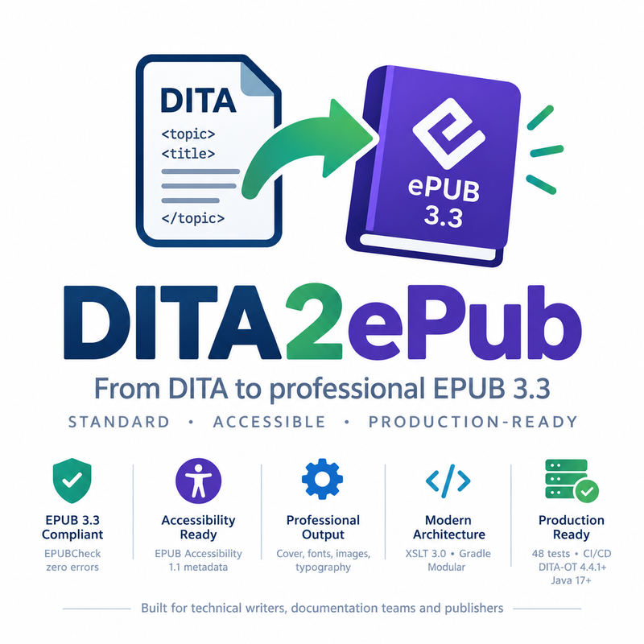

<a id="readme-top"></a>

<div align="center">




**A DITA Open Toolkit plugin that turns DITA maps and bookmaps into accessible EPUB 3.3 publications**

[](docs/CHANGELOG.md)
[](https://opensource.org/licenses/Apache-2.0)
[](https://www.dita-ot.org/)
[](https://www.w3.org/publishing/epub3/)
[](https://adoptium.net/)
[](#testing)


[Quick Start](#quick-start) • [Usage](#usage) • [Parameters](#configuration-parameters) • [Documentation](#documentation-hub)

</div>

---

## About

**DITA2ePub** is a DITA-OT plugin that transforms DITA content into standards-compliant EPUB 3.3 publications. It is
built for technical writers, documentation teams and publishers who need professional e-books with accessibility
metadata, from the same DITA sources as their other deliverables.

### Why DITA2ePub?

- **Standards-compliant**: EPUB 3.3 output that passes EPUBCheck, with EPUB Accessibility 1.1 metadata
- **Real-world DITA**: multi-folder, multi-map publications; the 234-topic DITA-OT user guide builds with no
  EPUBCheck error or warning
- **Professional output**: cover pages, themes, embedded fonts, optimized images, typographic features
- **Tested**: 47 JUnit tests, including end-to-end builds with DITA-OT, and 144 XSpec expectations on the XSLT modules
- **Developer-friendly**: modular XSLT 3.0, Gradle build, GitHub Actions workflows

### What's New in v2.1.0?

- **Real-world publications** — Only the root map is transformed; external links, non-DITA resources, key
  definitions and relationship tables are no longer treated as topics; cross-references resolve across folders
- **More DITA content rendered** — Nested and multi-topic files, definition and parameter lists, simple tables,
  examples, task blocks, related links, and the programming, software, user interface, XML mention and highlighting
  domains
- **EPUB Accessibility 1.1** — Metadata derived from the generated content; conformance is claimed only when the
  bookmap declares it with its evaluator (see [Accessibility Metadata](#accessibility-metadata))
- **EPUB 3.3 conformance** — Valid file names and manifest ids, correct font obfuscation key, only referenced images
  packaged, `data:` images kept, remote images and `file:` links handled (see the
  [conformance review](docs/EPUB33_CONFORMANCE.md))
- **Stable identifier** — Without an ISBN, the identifier is derived from the publication and is the same on every build
- **XSpec tests** of the XSLT modules, run by every `check`

Behaviour changes to know when upgrading: content file names no longer contain spaces or forbidden characters and
may be based on the topic path; `epub.accessibility` has no effect any more; DITA-OT no longer copies images into the
output folder next to the EPUB. See [CHANGELOG.md](docs/CHANGELOG.md) for the full list of changes.

### Previous Releases

- **v2.0.0**: Themes, platform profiles (Amazon KDP, Apple Books, Kobo), fixed layout, right-to-left languages, global figure/table numbering
- **v1.5.0**: Font obfuscation, image optimization, back-of-book index, consolidated glossary, List of Figures/Tables, auto-generated copyright page, drop caps
- **v1.4.0**: ISBN/ASIN identifiers, series metadata, BISAC codes, contributor roles, copyright page, landmarks
- **v1.3.0**: Custom CSS, footnotes with backlinks, figure/table numbering, pull quotes, sidebars
- **v1.2.0**: EPUB 3.3 compliance, NCX generation, EPUBCheck integration, cover pages, WCAG-AA metadata
- **v1.1.0**: Internationalized note labels (eleven languages), locale-aware quotation marks
- **v1.0.0**: Initial release with EPUB 3.3 generation, font embedding, navigation

---

## Key Features

### Core Capabilities
- **EPUB 3.3**: Output that follows the latest EPUB specification and the Structural Semantics Vocabulary (SSV)
- **DITA-OT 4.4+ integration**: Registered as the `epub3` transformation type
- **XHTML5 output**: Semantic content documents with `epub:type` annotations and ARIA roles
- **Accessibility**: EPUB Accessibility 1.1 metadata that reflects the actual content, skip-navigation links, alt text checks
- **Navigation**: Table of contents, landmarks and, for Amazon KDP or on request, an NCX

### Advanced Features
- **Theme system**: 5 built-in themes (default, academic, fiction, technical, training) via CSS custom properties
- **Platform profiles**: Target-specific output for Amazon KDP, Apple Books, Kobo, or generic EPUB
- **Fixed layout EPUB**: For children's books, cookbooks and comics, with viewport dimensions and rendition controls
- **Right-to-left languages**: Arabic, Hebrew, Farsi, Urdu with CSS logical properties and bidirectional text
- **Back-of-book index**: Built from `<indexterm>` elements, with nested entries, cross-references and anchor links
- **Consolidated glossary**: Built from `<glossentry>` topics, grouped alphabetically
- **Cover pages**: HTML cover pages in several styles
- **Font embedding and obfuscation**: TTF, OTF, WOFF, WOFF2, with generated `@font-face` rules and IDPF obfuscation
- **Image optimization**: JPEG quality control, maximum width, recursive directory scanning
- **Typography**: Drop caps, zebra-striped tables, figure/table numbering, locale-aware quotation marks
- **EPUBCheck 5.3.0**: Validation at the end of the build when EPUBCheck is available

### Developer Experience
- **Gradle build** with the Kotlin DSL; downloads DITA-OT and installs the plugin for testing
- **Modular architecture**: 9 XSLT 3.0 modules with a clear separation of concerns
- **Documentation**: Quick start, technical specification, EPUB 3 anatomy reference, conformance review, roadmap
- **CI/CD**: GitHub Actions workflows for builds, tests, documentation and releases

---

## Table of Contents

- [About](#about) - Why DITA2ePub? What's new?
- [Key Features](#key-features) - Core capabilities and advanced features
- [Requirements](#requirements) - System requirements
- [Quick Start](#quick-start) - Installation and first EPUB
- [Usage](#usage) - Examples
  - [Basic Transformation](#basic-transformation)
  - [Cover Page Generation](#cover-page-generation)
  - [Font Embedding](#font-embedding)
  - [Back-of-Book Index](#back-of-book-index)
  - [Consolidated Glossary](#consolidated-glossary)
  - [Advanced Configuration](#advanced-configuration)
- [Configuration Parameters](#configuration-parameters) - Complete reference
- [Project Structure](#project-structure) - Codebase organization
- [Testing](#testing) - Test suites and datasets
- [Documentation Hub](#documentation-hub) - All documentation links
- [Use Cases](#use-cases) - Typical configurations
- [Current Status](#current-status) - Release and roadmap
- [Contributing](#contributing) - How to contribute
- [License](#license) - Apache 2.0

---

## Requirements

| Component | Version | Notes |
|-----------|---------|-------|
| **DITA-OT** | 4.4+ | [Download](https://www.dita-ot.org/download); built and tested with 4.4.1 |
| **Java** | 17+ | [Adoptium OpenJDK](https://adoptium.net/) recommended |
| **Gradle** | — | Only to build the plugin; the Gradle 9 wrapper is included |

### Optional Tools
- **EPUBCheck** 5.3.0+ for validation ([Download](https://github.com/w3c/epubcheck/releases))
- **Calibre** or another reading system to view the EPUBs

---

## Quick Start

### 1. Installation

```bash
# Clone the repository
git clone https://github.com/jyjeanne/dita2epub.git
cd dita2epub

# Build the plugin package (build/plugin/io.github.jyjeanne.dita2epub.zip)
./gradlew packagePlugin

# Install it into your DITA-OT
$DITA_HOME/bin/dita install build/plugin/io.github.jyjeanne.dita2epub.zip
```

### 2. Verify Installation

```bash
# List installed plugins
dita plugins | grep epub

# Expected output:
# io.github.jyjeanne.dita2epub@2.1.0
```

### 3. Generate Your First EPUB

```bash
dita --input=mybook.ditamap --format=epub3 --output=output
```

**Done!** Your EPUB will be in `output/mybook.epub`

### Build Commands Reference

```bash
# Build and test
./gradlew build                  # Compile, tests and checks
./gradlew test                   # JUnit tests; the end-to-end tests also run when DITA_HOME is set (see Testing)
./gradlew xspecTest              # XSpec tests of the XSLT modules (no DITA-OT needed)

# EPUB generation (downloads DITA-OT 4.4.1 on first run)
./gradlew buildSampleEpub        # Build + validate sample EPUB
./gradlew buildAllEpubs          # Build all test datasets

# Validation
./gradlew validateEpub           # EPUBCheck on sample EPUB
./gradlew validateAllEpubs       # EPUBCheck on all outputs

# Full CI pipeline
./gradlew ciCheck                # Compile, test, build EPUBs, EPUBCheck
```

> **Windows:** the Gradle EPUB tasks (`buildSampleEpub`, `buildAllEpubs`, `ciCheck`, …) currently fail because the
> generated `dita.bat` command line exceeds the 8191-character `cmd.exe` limit. Run `dita` directly or use Linux/macOS;
> see [Known Limitations](docs/SPECIFICATION.md#known-limitations).

---

## Usage

### Basic Transformation

Transform a DITA bookmap to EPUB3:

```bash
dita --input=mybook.ditamap \
     --format=epub3 \
     --output=output
```

**Result**: Creates `output/mybook.epub` with default settings.

### Cover Page Generation

#### Automatic Cover Page with Full-Page Style

```bash
dita --input=mybook.ditamap \
     --format=epub3 \
     --output=output \
     --epub.cover.image=images/cover.jpg \
     --epub.generate.cover.page=yes \
     --epub.cover.page.style=full-page
```

#### Centered Cover Style

```bash
dita --input=mybook.ditamap \
     --format=epub3 \
     --output=output \
     --epub.cover.image=images/cover.jpg \
     --epub.cover.page.style=centered
```

**Available Styles**:
- `full-page` (default) - Cover fills entire viewport
- `centered` - Cover centered with padding
- `custom` - Use your own CSS

### Font Embedding

Embed custom fonts in your EPUB:

```bash
dita --input=mybook.ditamap \
     --format=epub3 \
     --output=output \
     --epub.embed.fonts=/path/to/fonts/ \
     --epub.custom.css=styles/fonts.css
```

**Supported Formats**: TTF, OTF, WOFF, WOFF2

**Font Directory Structure**:
```
fonts/
├── MyFont-Regular.woff2
├── MyFont-Bold.woff2
├── MyFont-Italic.woff2
└── MyFont-BoldItalic.woff2
```

The plugin packages the fonts and, with `epub.generate.font.css=yes` (the default), writes their `@font-face` rules
in `epub-fonts.css`: family, weight and style come from the file names (`MyFont-BoldItalic.woff2` is `MyFont`, 700,
italic). Apply the family in your own stylesheet, given with `epub.custom.css`:

```css
body {
  font-family: 'MyFont', serif;
}
```

Set `epub.obfuscate.fonts=yes` to obfuscate the embedded fonts with the IDPF algorithm.

### Back-of-Book Index

Generate an index from `<indexterm>` elements in your DITA topics:

```bash
dita --input=mybook.ditamap \
     --format=epub3 \
     --output=output \
     --epub.generate.index=yes
```

The index generator supports:
- Simple and nested index entries
- `<index-see>` ("See") cross-references
- `<index-see-also>` ("See also") cross-references
- `<index-sort-as>` for custom sort ordering
- Alphabetical grouping with chapter.section locators
- Precise anchor links to the exact location in the content

When set to `auto` (default), the index is generated automatically when a `<indexlist/>` element is present in the bookmap.

### Consolidated Glossary

Generate a consolidated glossary page from DITA `<glossentry>` topics:

```bash
dita --input=mybook.ditamap \
     --format=epub3 \
     --output=output \
     --epub.generate.glossary=auto
```

The glossary generator:
- Collects all `<glossentry>` topics referenced from a `<glossarylist>` in the bookmap
- Extracts `<glossterm>` and `<glossdef>` from each entry
- Groups entries alphabetically by first letter
- Produces a consolidated `glossary.xhtml` with EPUB 3.3 `<dl epub:type="glossary">` semantic markup
- Adds the glossary to the TOC, landmarks navigation, OPF manifest, and spine
- Individual glossentry XHTML files are suppressed in favor of the consolidated page

When set to `auto` (default), the glossary is generated automatically when a `<glossarylist>` with topicrefs is present in the bookmap backmatter.

**Bookmap structure**:
```xml
<backmatter>
  <booklists>
    <glossarylist>
      <topicref href="glossary/term-epub.dita" keys="gl-epub"/>
      <topicref href="glossary/term-dita.dita" keys="gl-dita"/>
    </glossarylist>
  </booklists>
</backmatter>
```

**Glossentry topic format**:
```xml
<?xml version="1.0" encoding="UTF-8"?>
<!DOCTYPE glossentry PUBLIC "-//OASIS//DTD DITA Glossary Entry//EN" "glossentry.dtd">
<glossentry id="epub">
  <glossterm>EPUB</glossterm>
  <glossdef>Electronic Publication — an open standard for digital books.</glossdef>
</glossentry>
```

### Advanced Configuration

Complete example with all major features:

```bash
dita --input=mybook.ditamap \
     --format=epub3 \
     --output=output \
     --epub.version=3.3 \
     --epub.cover.image=images/cover.svg \
     --epub.generate.cover.page=yes \
     --epub.cover.page.style=full-page \
     --epub.embed.fonts=fonts/ \
     --epub.generate.index=auto \
     --epub.generate.glossary=auto \
     --epub.toc.depth=4 \
     --epub.nav.depth=4 \
     --epub.validate=yes
```

---

## Configuration Parameters

### Core Parameters

| Parameter | Type | Default | Description |
|-----------|------|---------|-------------|
| `epub.version` | string | `3.3` | EPUB specification version (3.3, 3.0, 2.0.1) |
| `epub.toc.depth` | integer | `5` | Maximum table of contents depth |
| `epub.nav.depth` | integer | `5` | Maximum navigation document depth |
| `epub.aria.landmarks` | enum | `yes` | Generate ARIA landmarks |
| `epub.generate.ncx` | enum | `no` | Generate an EPUB 2 NCX file (always generated for `epub.platform=kdp`) |
| `epub.accessibility` | enum | `wcag-aa` | Deprecated: no effect on the output, kept so existing build scripts keep working; accessibility metadata is derived from the content, see [Accessibility Metadata](#accessibility-metadata) |

### Cover Page Parameters

| Parameter | Type | Default | Description |
|-----------|------|---------|-------------|
| `epub.cover.image` | path | `(none)` | Path to cover image file (JPG, PNG, SVG) |
| `epub.generate.cover.page` | boolean | `yes` | Generate HTML cover page from image |
| `epub.cover.page.style` | enum | `full-page` | Cover page style (full-page, centered, custom) |

### Index Parameters

| Parameter | Type | Default | Description |
|-----------|------|---------|-------------|
| `epub.generate.index` | enum | `auto` | Generate back-of-book index: `auto` (detect from bookmap), `yes`, `no` |

When set to `auto`, index generation triggers automatically when a `<indexlist/>` element is present in the bookmap. The index collects all `<indexterm>` elements from topics, groups them alphabetically, and generates an `index.xhtml` file with EPUB 3.3 Structural Semantics Vocabulary markup.

### Glossary Parameters

| Parameter | Type | Default | Description |
|-----------|------|---------|-------------|
| `epub.generate.glossary` | enum | `auto` | Generate consolidated glossary: `auto` (detect from bookmap), `yes`, `no` |

When set to `auto`, glossary generation triggers automatically when a `<glossarylist>` element with topicrefs is present in the bookmap. The glossary collects `<glossterm>` and `<glossdef>` from all referenced `<glossentry>` topics, groups them alphabetically, and generates a `glossary.xhtml` file with EPUB 3.3 `<dl epub:type="glossary">` markup.

### List of Figures / Tables Parameters

| Parameter | Type | Default | Description |
|-----------|------|---------|-------------|
| `epub.generate.lof` | enum | `no` | Generate List of Figures: `auto` (detect `<figurelist/>` in bookmap), `yes`, `no` |
| `epub.generate.lot` | enum | `no` | Generate List of Tables: `auto` (detect `<tablelist/>` in bookmap), `yes`, `no` |

### Font Parameters

| Parameter | Type | Default | Description |
|-----------|------|---------|-------------|
| `epub.embed.fonts` | path | `(none)` | Directory containing fonts to embed |
| `epub.obfuscate.fonts` | boolean | `no` | Enable IDPF font obfuscation |
| `epub.generate.font.css` | enum | `yes` | Generate the `@font-face` rules of the embedded fonts |

### Image Optimization Parameters

| Parameter | Type | Default | Description |
|-----------|------|---------|-------------|
| `epub.optimize.images` | boolean | `no` | Optimize images for EPUB (reduce file size) |
| `epub.image.jpeg.quality` | float | `0.8` | JPEG compression quality (0.0-1.0) |
| `epub.image.max.width` | integer | `0` | Max image width in pixels (0 = no limit) |

### Directory Structure

| Parameter | Type | Default | Description |
|-----------|------|---------|-------------|
| `epub.topics.dir` | string | `content` | Directory for topic XHTML files |
| `epub.images.dir` | string | `images` | Directory for images |
| `epub.fonts.dir` | string | `fonts` | Directory for embedded fonts |
| `epub.css.dir` | string | `styles` | Directory for CSS files |

### Metadata & Retail Distribution Parameters

| Parameter | Type | Default | Description |
|-----------|------|---------|-------------|
| `epub.isbn` | string | `(none)` | ISBN override (extracts from bookmap if empty) |
| `epub.series.name` | string | `(none)` | Series/collection name |
| `epub.series.position` | string | `(none)` | Volume position in series |
| `epub.bisac.codes` | string | `(none)` | Comma-separated BISAC subject codes |
| `epub.copyright.page` | enum | `auto` | Generate copyright page: `auto`, `yes`, `no` |

### Typography & Styling Parameters

| Parameter | Type | Default | Description |
|-----------|------|---------|-------------|
| `epub.custom.css` | path | `(none)` | Path to custom CSS file to include |
| `epub.figure.numbering` | enum | `global` | Figure numbering: `global`, `none` |
| `epub.table.numbering` | enum | `global` | Table numbering: `global`, `none` |
| `epub.table.zebra` | enum | `yes` | Zebra striping on table rows |
| `epub.code.line.numbers` | enum | `no` | Line numbers in code blocks |
| `epub.code.syntax.classes` | enum | `yes` | Language CSS class on code blocks |
| `epub.drop.caps` | enum | `no` | Drop caps on chapter first paragraphs |
| `epub.hyphenation` | enum | `auto` | CSS hyphenation mode: `auto`, `yes`, `no` |
| `epub.locale.quotes` | enum | `no` | Locale-aware quotation marks |

### Theme Parameters

| Parameter | Type | Default | Description |
|-----------|------|---------|-------------|
| `epub.theme` | enum | `default` | Visual theme: `default`, `academic`, `fiction`, `technical`, `training` |

### Platform Parameters

| Parameter | Type | Default | Description |
|-----------|------|---------|-------------|
| `epub.platform` | enum | `generic` | Target platform: `generic`, `kdp`, `apple`, `kobo` |

### Fixed Layout Parameters

| Parameter | Type | Default | Description |
|-----------|------|---------|-------------|
| `epub.layout` | enum | `reflowable` | Layout type: `reflowable`, `fixed` |
| `epub.fxl.width` | integer | `1024` | Viewport width in pixels |
| `epub.fxl.height` | integer | `768` | Viewport height in pixels |
| `epub.fxl.orientation` | enum | `auto` | Orientation: `auto`, `portrait`, `landscape` |
| `epub.fxl.spread` | enum | `auto` | Spread: `auto`, `both`, `landscape`, `none` |

### Validation

| Parameter | Type | Default | Description |
|-----------|------|---------|-------------|
| `epub.validate` | boolean | `yes` | Run EPUBCheck validation (if available) |

### Accessibility Metadata

The package document gets [EPUB Accessibility 1.1](https://www.w3.org/TR/epub-a11y-11/) discovery metadata
that describes the generated content: access modes (`visual` only when there are images), sufficient access
modes, features (`structuralNavigation`, `tableOfContents`, `readingOrder`, `ARIA`, plus `index` and
`alternativeText` when they apply), hazards, and a summary that reports images without a text alternative.

The plugin does not claim WCAG conformance by itself, since that requires an evaluation. After evaluating the
publication, declare the claim and the evaluator in the bookmap:

```xml
<bookmeta>
  <data name="accessibility-conformance" value="EPUB Accessibility 1.1 - WCAG 2.2 Level AA"/>
  <data name="accessibility-certifier" value="Example Accessibility Services"/>
  <!-- Optional: replaces the generated summary -->
  <data name="accessibility-summary" value="..."/>
</bookmeta>
```

These become `dcterms:conformsTo` and `a11y:certifiedBy`. A conformance value without a certifier is ignored
with a warning, because EPUB Accessibility 1.1 requires both.

**Complete Reference**: See [SPECIFICATION.md](docs/SPECIFICATION.md) for all parameters

---

## Project Structure

```
dita2epub/
├── src/
│   ├── main/
│   │   ├── java/               # Java utilities (packaging, font obfuscation, image optimization)
│   │   ├── xsl/                # XSLT 3.0 transformation modules (9 modules)
│   │   │   ├── map2epub3.xsl          # Main entry point
│   │   │   ├── epub3-params.xsl       # Parameter definitions
│   │   │   ├── epub3-common.xsl       # Common functions
│   │   │   ├── epub3-metadata.xsl     # Metadata extraction
│   │   │   ├── epub3-content.xsl      # Content generation
│   │   │   ├── epub3-impl.xsl         # OPF/navigation
│   │   │   ├── epub3-index.xsl        # Back-of-book index generation
│   │   │   ├── epub3-glossary.xsl     # Consolidated glossary generation
│   │   │   └── epub3-platform.xsl     # Platform-specific logic
│   │   └── resources/
│   │       ├── css/            # Stylesheets (8 files)
│   │       │   ├── epub-default.css         # Default styles (CSS custom properties)
│   │       │   ├── epub-theme-*.css         # Theme overrides (4 themes)
│   │       │   ├── epub-platform-kdp.css    # KDP-safe CSS
│   │       │   ├── epub-fxl.css             # Fixed Layout CSS overlay
│   │       │   └── epub-fonts.css           # Font declarations
│   │       └── fonts/          # Font directory (empty template)
│   ├── test/
│   │   ├── java/               # JUnit tests (8 classes)
│   │   ├── resources/
│   │   │   ├── dita/               # Complete English bookmap (18 topics, 10 glossary entries)
│   │   │   ├── dita-kdp/           # Amazon KDP commercial novel
│   │   │   ├── dita-comprehensive/ # Feature-coverage map
│   │   │   ├── dita-edge-cases/    # EPUB 3.3 conformance edge cases
│   │   │   └── epub/               # Public-domain reference EPUBs to compare the output with
│   │   └── xspec/              # XSpec tests of the XSLT modules, and their fixtures
│   └── xspecTest/java/         # JUnit runner of the XSpec tests
├── plugin.xml                  # DITA-OT plugin descriptor
├── plugin-info.xml             # Plugin metadata and release notes
├── io.github.jyjeanne.dita2epub.json  # Entry for the DITA-OT plugin registry (see docs/REGISTRY.md)
├── build-epub3.xml             # Ant build integration
├── build.gradle.kts            # Gradle build configuration (single source of the version)
└── docs/                       # Documentation
    ├── images/                 # README logo
    ├── ANATOMY_EPUB_THREE.md   # EPUB 3 file structure reference
    ├── CHANGELOG.md            # Version changelog
    ├── CONTRIBUTING.md         # Contribution guidelines
    ├── EPUB33_CONFORMANCE.md   # EPUB 3.3 conformance review
    ├── GITHUB_CHECKLIST.md     # GitHub procedures
    ├── PROJECT_STATUS.md       # Project status and metrics
    ├── QUICKSTART.md           # Quick start guide
    ├── REGISTRY.md             # Publishing to the DITA-OT plugin registry
    ├── RELEASE_NOTES.md        # Early release notes
    ├── ROADMAP.md              # Planned milestones and improvements
    ├── SPECIFICATION.md        # Complete technical specification
    ├── TEST_COVERAGE.md        # Test documentation
    └── TEST_SUMMARY.md         # Executive test summary
```

---

## Testing

### Test Suite Overview

- **47 JUnit tests** in 8 classes, including end-to-end builds with DITA-OT 4.4.1 that must pass EPUBCheck
- **144 XSpec expectations** on the XSLT modules, run with Saxon-HE 12.9 as in DITA-OT 4.4.1
- **4 test datasets**: complete English bookmap, Amazon KDP novel, a comprehensive feature map, and EPUB 3.3 edge cases
- **0 EPUBCheck errors** on generated EPUBs

### Running Tests

```bash
# JUnit tests only (no DITA-OT required; the end-to-end tests are skipped)
./gradlew test

# Full suite including the end-to-end tests (a few minutes)
./gradlew installLocalPlugin                            # downloads DITA-OT 4.4.1 and installs the plugin
export DITA_HOME=$PWD/build/dita-ot/dita-ot-4.4.1       # Windows: set DITA_HOME=%CD%\build\dita-ot\dita-ot-4.4.1
./gradlew test

# Single test class
./gradlew test --tests EpubValidatorTest

# View test report
open build/reports/tests/test/index.html
```

The end-to-end tests run the plugin installed in `DITA_HOME` (`bin/dita`, or `bin\dita.bat` on Windows). Re-run
`./gradlew installLocalPlugin` after changing XSLT, Ant, or CSS files.

### XSLT Unit Tests (XSpec)

The XSLT modules have [XSpec](https://github.com/xspec/xspec) tests in `src/test/xspec/`, run with Saxon-HE 12.9,
the XSLT processor of DITA-OT 4.4.1. They need no DITA-OT installation and run as part of `check`, hence of `build`.

```bash
./gradlew xspecTest
open build/reports/xspec/epub3-content-result.html   # XSpec report of one test file
```

| File | What it tests |
|------|---------------|
| `epub3-common.xspec` | Output file names and manifest ids, cross-reference targets, image paths, URI decoding, identifiers, media types, languages, fonts |
| `epub3-content.xspec` | XHTML rendering of DITA elements: topics, paragraphs, notes, links, images, figures, tables, lists, code, domain phrases |
| `epub3-metadata.xspec` | OPF package metadata and EPUB Accessibility 1.1 metadata |
| `epub3-navigation.xspec` | Table of contents of the navigation document, navigation titles, NCX navigation points |

The tests load the modules through `src/test/xspec/epub3-modules.xsl`, which includes them as `map2epub3.xsl` does,
without its DITA-OT HTML5 import. They run with `run-as="external"`, so that a fixture map from
`src/test/xspec/fixtures/` is the global context item the modules read, as in a real build. Each XSpec expectation is
reported as a JUnit test of the `xspecTest` suite (`src/xspecTest/java`).

### Test Datasets

The sample dataset at `src/test/resources/dita/` is a complete bookmap exercising every plugin feature:

| Element | Count | Description |
|---------|-------|-------------|
| Topics | 18 | Frontmatter, chapters, appendices, backmatter |
| Glossary entries | 10 | Alphabetically grouped |
| Index terms | 100+ | Two-level with cross-references |
| Figures | 4 | SVG diagrams with alt text |
| Tables | 6 | With zebra striping and captions |
| Footnotes | 8 | With backlinks |
| Note types | 6 | Default, tip, important, warning, caution, danger |
| Bookmap features | All | Cover, title page, copyright, TOC, LOF, LOT, glossary, index |

Three more datasets are used by the build and the end-to-end tests: `src/test/resources/dita-kdp/` (commercial novel
built with the KDP platform profile), `src/test/resources/dita-comprehensive/` (feature-coverage map, including topics
that share a file name across folders), and `src/test/resources/dita-edge-cases/` (inputs behind the
[EPUB 3.3 conformance review](docs/EPUB33_CONFORMANCE.md): file names that differ only in case, a file name with a
space, remote, `data:` and unreferenced images, a TOC heading cut by `epub.toc.depth`), whose EPUB must pass EPUBCheck
with no errors or warnings.

`src/test/resources/epub/` holds three public-domain EPUBs from [Standard Ebooks](https://standardebooks.org/) to
compare the output with in a reading system; no test reads them (see its
[README](src/test/resources/epub/README.md)).

### Test Coverage

| Area | Test class | Tests |
|------|------------|-------|
| Cover page generation | `CoverPageGenerationTest` | 7 |
| Font embedding | `FontEmbeddingTest` | 6 |
| Font obfuscation | `FontObfuscatorTest` | 4 |
| OPF manifest | `OPFManifestTest` | 8 |
| EPUB structure | `EpubStructureTest` | 10 |
| Validation | `EpubValidatorTest` | 8 |
| End-to-end builds with DITA-OT | `EpubGenerationIntegrationTest`, `EpubConformanceIntegrationTest` | 4 |
| XSLT modules | XSpec (`src/test/xspec/`) | 144 expectations |

---

## Documentation Hub

### Getting Started

| Document | Description | For |
|----------|-------------|-----|
| **[QUICKSTART.md](docs/QUICKSTART.md)** | 5-minute setup and first EPUB | New users |
| **[SPECIFICATION.md](docs/SPECIFICATION.md)** | Complete technical specification | All users |
| **[ANATOMY_EPUB_THREE.md](docs/ANATOMY_EPUB_THREE.md)** | EPUB 3 file structure and SSV reference | Developers |
| **[PROJECT_STATUS.md](docs/PROJECT_STATUS.md)** | Current status and metrics | Project overview |
| **[ROADMAP.md](docs/ROADMAP.md)** | Planned milestones and improvements | Next releases |

### User Documentation

| Document | Description | Details |
|----------|-------------|---------|
| **[Font Embedding Guide](src/main/resources/fonts/README.md)** | Font setup and configuration | Step-by-step setup, obfuscation, font licensing |
| **[CHANGELOG.md](docs/CHANGELOG.md)** | Version changelog | All releases up to v2.1.0 |
| **[RELEASE_NOTES.md](docs/RELEASE_NOTES.md)** | Early release notes | v1.0.1 release details |

### Testing & Quality

| Document | Description | Coverage |
|----------|-------------|----------|
| **[EPUB33_CONFORMANCE.md](docs/EPUB33_CONFORMANCE.md)** | EPUB 3.3 conformance review | Fixed and open findings |
| **[TEST_COVERAGE.md](docs/TEST_COVERAGE.md)** | Detailed test documentation | Written for v1.0.1; see [Testing](#testing) for the current suites |
| **[TEST_SUMMARY.md](docs/TEST_SUMMARY.md)** | Executive test summary | Written for v1.0.1 |

### Development & CI/CD

| Document | Description | Content |
|----------|-------------|---------|
| **[CONTRIBUTING.md](docs/CONTRIBUTING.md)** | Contribution guidelines | Setup, coding standards, pull requests |
| **[.github/ACTIONS_SETUP.md](.github/ACTIONS_SETUP.md)** | CI/CD setup summary | Workflow descriptions (written for v1.0.1) |
| **[REGISTRY.md](docs/REGISTRY.md)** | Publishing to the DITA-OT plugin registry | Release and checksum steps |

### External Resources

- **[GitHub Repository](https://github.com/jyjeanne/dita2epub)** - Source code and releases
- **[GitHub Issues](https://github.com/jyjeanne/dita2epub/issues)** - Bug reports and feature requests
- **[DITA-OT Documentation](https://www.dita-ot.org/)** - DITA Open Toolkit docs
- **[EPUB 3.3 Specification](https://www.w3.org/publishing/epub3/)** - W3C EPUB standard
- **[EPUB Accessibility 1.1](https://www.w3.org/TR/epub-a11y-11/)** - W3C accessibility requirements for EPUB

---

## Use Cases

### Technical Documentation
```bash
dita --input=user-guide.ditamap \
     --format=epub3 \
     --epub.theme=technical \
     --epub.toc.depth=6
```

### E-Books with Custom Branding
```bash
dita --input=novel.ditamap \
     --format=epub3 \
     --epub.theme=fiction \
     --epub.cover.image=cover.jpg \
     --epub.embed.fonts=fonts/ \
     --epub.cover.page.style=full-page
```

### Amazon KDP Publishing
```bash
dita --input=novel.ditamap \
     --format=epub3 \
     --epub.platform=kdp \
     --epub.cover.image=cover.jpg \
     --epub.isbn=978-0-00-000000-2
```

### Apple Books Publishing
```bash
dita --input=textbook.ditamap \
     --format=epub3 \
     --epub.platform=apple \
     --epub.embed.fonts=fonts/ \
     --epub.theme=academic
```

### Fixed Layout (Children's Books, Cookbooks)
```bash
dita --input=cookbook.ditamap \
     --format=epub3 \
     --epub.layout=fixed \
     --epub.fxl.width=1024 \
     --epub.fxl.height=768 \
     --epub.fxl.orientation=portrait
```

### Training Materials
```bash
dita --input=training.ditamap \
     --format=epub3 \
     --epub.theme=training \
     --epub.generate.cover.page=yes
```

---

## Current Status

**Version 2.1.0** builds real-world DITA publications as valid EPUB 3.3: the DITA-OT 4.4.1 user guide (234 topics,
many folders and maps) passes EPUBCheck with no errors or warnings, and so do the test datasets. All features of
2.0.0 are included: themes, platform profiles, fixed layout, right-to-left languages, index, glossary, lists of
figures and tables.

- What changed in each release: [CHANGELOG.md](docs/CHANGELOG.md)
- What comes next (EPUB 3.3 recommendations, inline SVG and MathML, syntax diagrams, validation tooling):
  [ROADMAP.md](docs/ROADMAP.md)
- Open EPUB 3.3 findings: [EPUB33_CONFORMANCE.md](docs/EPUB33_CONFORMANCE.md)

---

## Contributing

Contributions are welcome! Please see [CONTRIBUTING.md](docs/CONTRIBUTING.md) for:
- Code of conduct
- Development setup
- Coding standards
- Pull request process
- Testing requirements

### Quick Contribution Guide

1. Fork the repository
2. Create a feature branch (`git checkout -b feature/amazing-feature`)
3. Make your changes
4. Add tests for new features (JUnit, or XSpec for XSLT changes)
5. Run the checks (`./gradlew check`)
6. Commit changes (`git commit -m 'Add amazing feature'`)
7. Push to branch (`git push origin feature/amazing-feature`)
8. Open a Pull Request

---

## License

This project is licensed under the **Apache License 2.0** - see the [LICENSE](LICENSE) file for details.

```
Copyright 2025 J. Jeanne

Licensed under the Apache License, Version 2.0 (the "License");
you may not use this file except in compliance with the License.
You may obtain a copy of the License at

    http://www.apache.org/licenses/LICENSE-2.0
```

---

## Acknowledgments

### Built With
- [DITA Open Toolkit 4.4.1](https://www.dita-ot.org/)
- [Saxon-HE 12.9](https://www.saxonica.com/html/documentation12/about/) (XSLT 3.0), as shipped with DITA-OT 4.4.1
- [EPUBCheck 5.3.0](https://github.com/w3c/epubcheck)
- [Gradle 9](https://gradle.org/) with [dita-ot-gradle 2.8.5](https://github.com/jyjeanne/dita-ot-gradle)
- [JUnit 5](https://junit.org/junit5/) + [XMLUnit](https://github.com/xmlunit/xmlunit) + [AssertJ](https://assertj.github.io/doc/)
- [XSpec 4.1.2](https://github.com/xspec/xspec) for the XSLT tests

### Inspired By
- [DITA4Publishers](https://github.com/dita4publishers/dita4publishers) by Eliot Kimber
- DITA-OT community contributions
- [EPUB 3.3 Specification](https://www.w3.org/publishing/epub3/) by W3C

---

## Support & Contact

- **Issues**: [GitHub Issues](https://github.com/jyjeanne/dita2epub/issues)
- **Author**: J. Jeanne

---

## Project Status


**Last Updated**: October 27, 2026
**Version**: 2.1.0
**Status**: Production Ready

---

<div align="center">

**[Back to Top](#readme-top)**

Made with care for the DITA community

</div>
