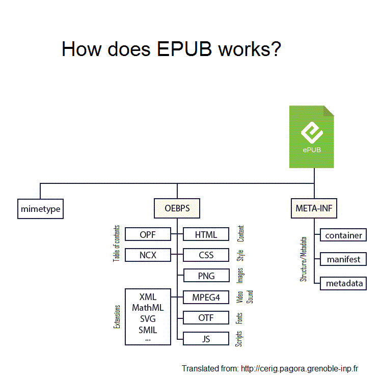

# Anatomy of an EPUB 3 File

An EPUB 3 archive has a **skeleton** – the files which are mandatory to structure the content – and some **flesh** – the ebook content.

As explained in the introduction, the flesh is a set of (X)HTML 5 and CSS resources, JavaScript code, images, audio, and video assets. Let’s focus on the skeleton, which is specified as the **EPUB Open Container Format (OCF)**.

---

## Mime Type

The first file you may spot in the ZIP archive is the `mimetype` file, which states that this archive is *really* an EPUB publication.

The content of this text file must be:

```
application/epub+zip
```

and nothing else. This is how an EPUB reading system ensures it can process the ebook.

It is required that the `mimetype` file is the first file found in the ZIP archive. This may appear to be a weird constraint, but it originates in the Open Document file format, which was the source of the EPUB file format. The rationale behind it is that if an application reads the first bytes of the archive, it will always find the same “magic numbers” (OCF magic numbers). This can replace detection of the format in case the file extension `.epub` is not reliable.

A practical issue with this requirement is that one cannot create a proper EPUB file with a simple ZIP tool: generic tools cannot guarantee that the `mimetype` file will be first in the archive.

---

## container.xml

This small XML file, found in the mandatory `META-INF` directory, is a bootstrapping item. It simply contains the relative location of the `.opf` file (a.k.a. package document), which is the brain of the publication and will be described shortly.

If the `content.opf` file is, for instance, in the folder `content` in the archive, then the location will be:

```
content/content.opf
```

Example:

```xml
<?xml version="1.0"?>
<container xmlns="urn:oasis:names:tc:opendocument:xmlns:container" version="1.0">
 <rootfiles>
  <rootfile full-path="content/content.opf" media-type="application/oebps-package+xml"/>
 </rootfiles>
</container>
```

Using this information, the reading system will be able to open the `.opf` file and know more about the structure of the publication.

### Multiple Renditions

EPUB 3 supports multiple renditions of a publication. You may find, for instance, a fixed-layout rendition and a reflowable rendition packaged in the same EPUB file. In such a case, `container.xml` will reference several package documents, usually placed in different directories.

Apart from `container.xml`, you may find other files in the `META-INF` directory, such as:

* `signatures.xml` (digital signatures of the container and its contents)
* `metadata.xml`
* `manifest.xml`
* Proprietary files like `com.apple.ibooks.display-options.xml`

Their presence is rather exceptional, so we won’t describe them in detail here.

---

## The .opf File (Package Document)

This XML file carries bibliographic and structural metadata about an EPUB publication (or rendition), and is the primary source of information about how to process and display that publication.

In this file, the reading system will find:

---

### 1. Metadata

Information about the publication (or rendition) content.

Diverse sets of metadata (e.g., ONIX) can be expressed as XML elements from different schemes. The only required elements in EPUB 3.0.1 are:

* `title`
* `identifier`
* `language`
* `modified`

These come from the Dublin Core set.

A fixed-layout publication must be tagged by a specific metadata item. Other metadata can be expressed:

* Inline, using a generic `<meta>` element
* As an external resource via a `<link>` element

---

### 2. Manifest

The exhaustive list of all publication (or rendition) resources, including:

* (X)HTML chapters
* Images
* Video or audio files
* Fonts
* Scripts
* CSS files

The reading system will only process the files listed in the manifest. From their media type (MIME type), it knows how to process them.

From the declared properties, the reading system can determine whether a file is:

* A navigation document
* A cover image
* A vector graphic
* A script

If the reading system cannot process a resource because its format is exotic, it will find here the fallback resource it can process instead.

---

### 3. Spine

As its name indicates, this is the “backbone” where the reading system finds the default reading order of all publication “chapters”.

Since these sections may not literally represent book chapters, each item in the sequence is called a **spine item**.

Each spine item references a manifest item.

Spine items can be declared as **non-linear**, meaning they are not displayed in the normal flow but can be reached from another spine item as supplementary content (e.g., popup content).

---

## Example Package Document

Below is a simple package document with metadata, a manifest, and a spine.

Please focus on the `version` attribute of the `<package>` element, which takes `"3.0"` as a value (this value does not change for minor versions like 3.3).

This `version` attribute indicates that the publication should be processed as EPUB 3. Apart from that, the file is mostly identical to an old EPUB 2 file.

Some EPUB 2 elements are deprecated, such as:

* `<guide>`
* The `toc` attribute of the `<spine>` element

However, they can still be used for perfect compatibility with EPUB 2 reading apps.

```xml
<?xml version="1.0" encoding="UTF-8"?>
<package xmlns="http://www.idpf.org/2007/opf" xmlns:opf="http://www.idpf.org/2007/opf" version="3.0" unique-identifier="BookID">
  <metadata xmlns:dc="http://purl.org/dc/elements/1.1/">
   <dc:identifier id="BookID" opf:scheme="isbn">978-3-86680-192-9</dc:identifier>
   <dc:identifier>3b622266-b838-4003-bcb8-b126ee6ae1a2</dc:identifier>
   <dc:title>The title</dc:title>
   <dc:language>fr</dc:language>
   <dc:publisher>The publisher</dc:publisher>
   <dc:creator>The author</dc:creator>
   <dc:contributor>A contributor</dc:contributor>
   <dc:description>A description</dc:description>
   <dc:subject>A subject of the publication</dc:subject>
   <dc:subject>Another subject of the publication</dc:subject>
   <dc:rights>© copyright notice</dc:rights>
   <meta property="dcterms:modified">2020-01-01T01:01:01Z</meta>
  </metadata>
  <manifest>
   <item id="coverimage" href="Images/cover.jpg" media-type="image/jpeg" properties="cover-image"/>
   <item id="cover" href="Text/cover.xhtml" media-type="application/xhtml+xml"/>
   <item id="toc" href="toc.html" media-type="application/xhtml+xml" properties="nav"/>
   <item id="chapter-1" href="Text/chapter-1.xhtml" media-type="application/xhtml+xml"/>
   <item id="chapter-2" href="Text/chapter-2.xhtml" media-type="application/xhtml+xml"/>
   <item id="css" href="Styles/publication.css" media-type="text/css"/>
   <item id="font1" href="Fonts/Andada-Italic.otf" media-type="application/vnd.ms-opentype"/>
   <item id="font2" href="Fonts/Andada-Regular.otf" media-type="application/vnd.ms-opentype"/>
   <item id="glyph" href="Images/glyph.png" media-type="image/png"/>
  </manifest>
  <spine>
   <itemref idref="cover"/>
   <itemref idref="toc"/>
   <itemref idref="chapter-1"/>
   <itemref idref="chapter-2"/>
  </spine>
</package>
```

---

## The Legacy .ncx File

A quick word about this file, sometimes found in EPUB 3 containers: this is the deprecated EPUB 2 way of declaring a navigation document.

Some EPUB 3 authors still prefer to include it so that EPUB 2 reading systems can process the publication. An EPUB 3 reading system will not access it, so we won’t describe its content.

---

## A Simple Diagram to Summarize

Here is a diagram illustrating the complete structure of an EPUB file.




### The Structure of an EPUB File

In this example, we find the `.opf` file and all content files in a directory named `OEBPS`.

Why such a strange name?

This is historical: **Open eBook Publication Structure** was the name of a legacy ebook format that has been superseded by the EPUB format. The acronym found its way into publishing vocabulary and is still used by some EPUB authoring tools when structuring an EPUB publication, so that the `.opf` file and content files are not stored in the root of the EPUB archive (which would still be harmless, by the way).

---

## The Navigation Document (nav.xhtml)

One of the most significant additions in EPUB 3 is the **EPUB Navigation Document**, which replaces the legacy NCX file as the primary means of navigation.

The navigation document is an XHTML content document that contains specialized `<nav>` elements, each identified by an `epub:type` attribute. It must be referenced in the manifest with `properties="nav"`.

### Required: Table of Contents (`toc`)

Every EPUB 3 publication **must** contain a `<nav epub:type="toc">` element. This is the primary table of contents that reading systems present to users.

The structure uses nested `<ol>` / `<li>` lists. Each `<li>` contains either:

* An `<a>` element linking to a content document (for navigable entries)
* A `<span>` element (for heading-only items with no direct link target), optionally followed by a nested `<ol>` for children

```xml
<nav epub:type="toc" id="toc" role="doc-toc">
  <h1>Table of Contents</h1>
  <ol>
    <li><a href="cover.xhtml">Cover</a></li>
    <li><a href="chapter-1.xhtml">Chapter 1: Introduction</a></li>
    <li>
      <a href="chapter-2.xhtml">Chapter 2: Main Topic</a>
      <ol>
        <li><a href="section-2-1.xhtml">2.1 First Section</a></li>
        <li><a href="section-2-2.xhtml">2.2 Second Section</a></li>
      </ol>
    </li>
    <li><a href="index.xhtml">Index</a></li>
  </ol>
</nav>
```

### Recommended: Landmarks (`landmarks`)

The `<nav epub:type="landmarks">` element provides quick access to key structural components of the publication. Each entry uses `epub:type` to identify the kind of landmark.

The `hidden` attribute is typically set on this `<nav>` to prevent it from displaying in the reading flow while remaining accessible to reading systems.

```xml
<nav epub:type="landmarks" id="landmarks" hidden="">
  <h1>Landmarks</h1>
  <ol>
    <li><a epub:type="toc" href="nav.xhtml#toc">Table of Contents</a></li>
    <li><a epub:type="bodymatter" href="chapter-1.xhtml">Start of Content</a></li>
    <li><a epub:type="index" href="index.xhtml">Index</a></li>
  </ol>
</nav>
```

### Optional: Page List (`page-list`)

For publications derived from print editions, a `<nav epub:type="page-list">` element can map EPUB locations to the original print page numbers. This allows reading systems to display page numbers and enables users to reference specific pages.

```xml
<nav epub:type="page-list">
  <h1>Pages</h1>
  <ol>
    <li><a href="chapter-1.xhtml#page1">1</a></li>
    <li><a href="chapter-1.xhtml#page2">2</a></li>
  </ol>
</nav>
```

---

## Content Documents (XHTML)

The "flesh" of an EPUB is made of **XHTML Content Documents** -- the actual text, images, and media that the reader sees. EPUB 3.3 requires these documents to use the **XML serialization of HTML5** (XHTML5).

### Key Requirements

* Documents must be **well-formed XML** (proper nesting, self-closing tags like `<br/>`, quoted attributes)
* The root `<html>` element must declare the XHTML namespace: `xmlns="http://www.w3.org/1999/xhtml"`
* An `xml:lang` attribute should be set on `<html>` to declare the document language
* The `epub:` namespace (`http://www.idpf.org/2007/ops`) must be declared when using structural semantics

### Minimal Content Document

```xml
<?xml version="1.0" encoding="UTF-8"?>
<html xmlns="http://www.w3.org/1999/xhtml"
      xmlns:epub="http://www.idpf.org/2007/ops"
      xml:lang="en">
  <head>
    <meta charset="UTF-8"/>
    <title>Chapter 1</title>
    <link rel="stylesheet" type="text/css" href="../styles/publication.css"/>
  </head>
  <body>
    <article epub:type="chapter">
      <h1>Chapter 1: Introduction</h1>
      <p>The content of the chapter goes here.</p>
    </article>
  </body>
</html>
```

### Embedded Content

EPUB 3 content documents may include:

* **SVG** -- vector graphics embedded inline via `<svg>` elements or referenced as separate files
* **MathML** -- mathematical formulas using Presentation Markup (Content MathML is not supported)
* **Audio and Video** -- via standard HTML5 `<audio>` and `<video>` elements
* **Scripting** -- JavaScript is allowed but must be identified with `properties="scripted"` in the manifest. Reading systems are not required to support scripting.

---

## Structural Semantics Vocabulary (`epub:type`)

EPUB 3 defines the **Structural Semantics Vocabulary** (SSV), a set of standardized `epub:type` attribute values that convey the structural role of elements. This enables reading systems to provide enhanced navigation and presentation.

The `epub:type` attribute is placed on HTML elements to express their semantic purpose. Multiple values can be combined (space-separated).

### Document Partitions

| Value | Description |
|-------|-------------|
| `cover` | Introductory section with marketing image, title, and author |
| `frontmatter` | Preliminary material (table of contents, dedication, foreword) |
| `bodymatter` | The main content of the publication |
| `backmatter` | Ancillary material (index, appendices, bibliography) |

### Document Divisions

| Value | Description |
|-------|-------------|
| `part` | A major structural division containing related chapters |
| `volume` | A component of a multi-volume collection |
| `chapter` | A major thematic section of content |
| `division` | A major structural division, especially in legal/legislative works |

### Document Sections

| Value | Description |
|-------|-------------|
| `foreword` | Introductory section not written by the author |
| `preface` | Introductory section written by the author |
| `introduction` | Section introducing the scope or nature of the work |
| `appendix` | Supplemental information after the primary content |
| `glossary` | A brief dictionary of specialized terms |
| `bibliography` | A list of external references cited in the work |
| `index` | A detailed navigational aid linking to key subjects and names |
| `colophon` | Production notes particular to the edition |
| `conclusion` | A concluding section summarizing the work |
| `epilogue` | A concluding narrative section |
| `afterword` | A closing statement from the author |

### Navigation and Reference

| Value | Description |
|-------|-------------|
| `toc` | Table of contents |
| `landmarks` | References to recurring publication components |
| `page-list` | Links to pagebreaks in the content |
| `pagebreak` | A location in the content corresponding to a print page boundary |
| `footnote` | A note at the bottom of a page |
| `endnote` | A note at the end of a section or work |
| `noteref` | A reference to a footnote or endnote |

---

## Back-of-Book Index

EPUB 3 provides a rich set of semantic types specifically for indexes, enabling reading systems to identify and present index content with appropriate behavior (e.g., special formatting, search integration).

### Index Semantic Types

| `epub:type` Value | Element | Description |
|-------------------|---------|-------------|
| `index` | `<body>`, `<section>` | The overall index container |
| `index-group` | `<section>` | A group of entries sharing a characteristic (typically a letter) |
| `index-entry-list` | `<ul>` | A collection of consecutive index entries |
| `index-entry` | `<li>` | One term with locators, subentries, and cross-references |
| `index-term` | `<span>` | The word or phrase representing the indexed content |
| `index-locator` | `<a>` | A link to an occurrence of the indexed content |
| `index-locator-list` | `<ul>` | A collection of sequential locators |
| `index-headnotes` | `<header>`, `<section>` | Content helping users understand the index |
| `index-xref-preferred` | flow content | A "See" cross-reference to a preferred term |
| `index-xref-related` | flow content | A "See also" cross-reference to a related term |

### Example Index Markup

```xml
<body epub:type="index">
  <h1>Index</h1>
  <section epub:type="index-group" id="index-A">
    <h2>A</h2>
    <ul epub:type="index-entry-list">
      <li epub:type="index-entry">
        <span epub:type="index-term">Alphabetization</span>,
        <a epub:type="index-locator" href="ch06.xhtml#ixa-ch06-5">6.2</a>
        <ul epub:type="index-entry-list">
          <li epub:type="index-entry">
            <span epub:type="index-term">letter-by-letter</span>,
            <a epub:type="index-locator" href="ch06.xhtml#ixa-ch06-8">6.3</a>
          </li>
          <li epub:type="index-entry">
            <span epub:type="index-term">word-by-word</span>,
            <a epub:type="index-locator" href="ch06.xhtml#ixa-ch06-12">6.4</a>
          </li>
        </ul>
      </li>
      <li epub:type="index-entry">
        <span epub:type="index-term">ASI</span>.
        <span epub:type="index-xref-preferred">
          <em>See</em> American Society of Indexers
        </span>
      </li>
      <li epub:type="index-entry">
        <span epub:type="index-term">Authors</span>,
        <a epub:type="index-locator" href="ch08.xhtml#ixa-ch08-3">8.2</a>.
        <span epub:type="index-xref-related">
          <em>See also</em> Author/editor relationships
        </span>
      </li>
    </ul>
  </section>
</body>
```

### Index Locators in Reflowable EPUB

Unlike print books, reflowable EPUB publications have no fixed page numbers. Index locators therefore link to **anchor points** within the content rather than page numbers. Common display strategies include:

* **Chapter.section numbers** (e.g., `6.2`) -- compact and familiar to readers
* **Chapter numbers only** (e.g., `6`) -- simpler but less precise
* **Section titles** -- descriptive but can make the index very verbose

The locator `<a>` elements use fragment identifiers (`#anchor-id`) to point to precise locations within content documents, allowing readers to jump directly to the relevant passage.

---

## Accessibility

EPUB 3.3 **recommends** conformance to the [EPUB Accessibility 1.1](https://www.w3.org/TR/epub-a11y-11/) specification, which itself builds on WCAG 2 guidelines.

### Key Accessibility Features

* **Language declaration** -- `xml:lang` on the `<html>` element of every content document
* **Alternative text** -- `alt` attributes on all images
* **Document structure** -- Proper heading hierarchy (`<h1>` through `<h6>`), semantic HTML elements (`<nav>`, `<main>`, `<article>`, `<section>`, `<aside>`)
* **ARIA roles** -- `role="doc-toc"`, `role="main"`, `role="note"` for assistive technology
* **Skip navigation** -- Links allowing screen readers to bypass repeated navigation blocks
* **Accessibility metadata** -- Declared in the OPF package document:

```xml
<meta property="schema:accessMode">textual</meta>
<meta property="schema:accessMode">visual</meta>
<meta property="schema:accessModeSufficient">textual</meta>
<meta property="schema:accessibilityFeature">structuredNavigation</meta>
<meta property="schema:accessibilityFeature">tableOfContents</meta>
<meta property="schema:accessibilityFeature">index</meta>
<meta property="schema:accessibilityHazard">none</meta>
<meta property="schema:accessibilitySummary">
  This publication is structured with semantic HTML and includes
  a table of contents and back-of-book index.
</meta>
```

---

## Fixed Layout vs. Reflowable

EPUB 3 supports two fundamentally different presentation models.

### Reflowable (Default)

The text reflows to fit the screen size. The reader can adjust font size, margins, and line spacing. This is the default mode and requires no special metadata.

Reflowable content is ideal for text-heavy publications like novels, textbooks, and reference works.

### Fixed Layout

Each page has a fixed size and content is positioned absolutely. The reading system displays pages as designed, scaling them to fit the screen but preserving the layout.

Fixed layout is used for illustrated books, comics, magazines, and children's books where precise visual layout is essential.

Fixed layout requires specific metadata in the OPF:

```xml
<meta property="rendition:layout">pre-paginated</meta>
<meta property="rendition:spread">landscape</meta>
```

And each content document must declare its viewport dimensions:

```html
<meta name="viewport" content="width=1024, height=768"/>
```

---

## Media Overlays

EPUB 3 supports **Media Overlays**, which synchronize pre-recorded audio narration with the text content. This feature is particularly useful for audiobook/ebook hybrids, children's books, and accessible publications.

Media overlay documents use a subset of SMIL 3.0 (Synchronized Multimedia Integration Language). They are XML files that pair text fragments with audio clips:

```xml
<smil xmlns="http://www.w3.org/ns/SMIL" version="3.0">
  <body>
    <seq id="seq1">
      <par id="par1">
        <text src="chapter-1.xhtml#para1"/>
        <audio src="audio/chapter1.mp3" clipBegin="0s" clipEnd="3.5s"/>
      </par>
      <par id="par2">
        <text src="chapter-1.xhtml#para2"/>
        <audio src="audio/chapter1.mp3" clipBegin="3.5s" clipEnd="7.2s"/>
      </par>
    </seq>
  </body>
</smil>
```

The reading system highlights each text passage as the corresponding audio plays, providing a synchronized read-along experience.

---

## Complete EPUB 3 File Structure

Putting it all together, a typical EPUB 3 publication has the following structure:

```
my-book.epub (ZIP archive)
|
+-- mimetype                          (MUST be first, uncompressed)
|
+-- META-INF/
|   +-- container.xml                 (points to the .opf file)
|
+-- content/                          (or OEBPS/, or any directory name)
    +-- content.opf                   (package document: metadata + manifest + spine)
    +-- nav.xhtml                     (navigation document: toc + landmarks)
    +-- cover.xhtml                   (cover page)
    +-- titlepage.xhtml               (title page)
    +-- chapter-01.xhtml              (content documents)
    +-- chapter-02.xhtml
    +-- ...
    +-- index.xhtml                   (back-of-book index)
    +-- styles/
    |   +-- publication.css           (stylesheets)
    +-- images/
    |   +-- cover.jpg                 (cover image)
    |   +-- figure-1.png              (content images)
    +-- fonts/
        +-- MyFont-Regular.woff2      (embedded fonts)
```

The reading system processes these files in this order:

1. Read `mimetype` to confirm this is an EPUB archive
2. Open `META-INF/container.xml` to locate the package document
3. Parse the `.opf` file to learn about metadata, manifest, and reading order
4. Load the navigation document to build the table of contents
5. Present the content documents in spine order to the reader

---

## References

* [EPUB 3.3 Specification](https://www.w3.org/TR/epub-33/) -- W3C Recommendation, January 2026
* [EPUB 3 Structural Semantics Vocabulary](https://www.w3.org/TR/epub-ssv/) -- Defines `epub:type` values
* [EPUB Accessibility 1.1](https://www.w3.org/TR/epub-a11y-11/) -- Accessibility conformance requirements
* [EPUB Open Container Format (OCF) 3.3](https://www.w3.org/TR/epub-33/#sec-ocf) -- ZIP packaging rules
* [EPUBCheck](https://www.w3.org/publishing/epubcheck/) -- Official EPUB validation tool
